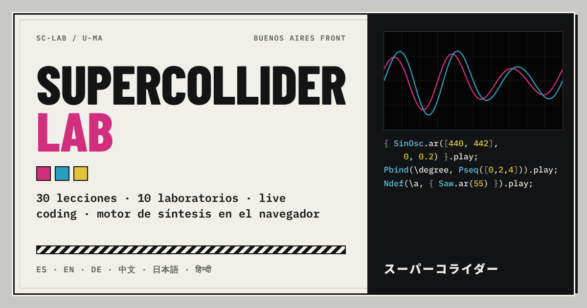

# SuperCollider Lab · U-MA コライダー

Aprendé **SuperCollider** en el navegador: 30 lecciones, 10 laboratorios, código libre, referencia y consejos, con un motor de síntesis en tiempo real. Escribís código de SuperCollider, lo ejecutás con **Ctrl + Enter** y lo ves sonar: osciloscopio, espectro, sonograma, grafo de UGens en vivo, árbol de nodos y línea de tiempo de eventos. No hay que instalar ni cargar nada.

**▶ Abrir la app:** https://buenosairesfront.github.io/supercollider/

Parte de [Buenos Aires Front](https://www.instagram.com/buenos.aires.front/) · herramientas U-MA.

**Idiomas:** Español · English · Deutsch · 中文 · 日本語 · हिन्दी



---

## Qué tiene

- **Curso de 7 módulos y 30 lecciones**: primeros pasos, UGens, técnicas de síntesis, el servidor, tiempo y patterns, live coding y aplicaciones (afinaciones, sonificación, espacialización, escucha automática).
- **Cada lección**: explicación, ejemplos editables y ejecutables, una cita breve del libro de referencia, un consejo pro, un quiz y un **desafío que se corrige solo** (analiza los UGens que usaste, si sonó, cuántas notas tocó un pattern, etc.).
- **10 laboratorios**: osciladores, sintetizador sustractivo con teclado, FM, aditiva con drawbars, editor de envolventes, secuenciador de patterns, granular, afinación (EDO vs. justa), cadena de efectos y caos. Cada control reescribe el código de SuperCollider en vivo.
- **Código libre**: cuaderno con archivos guardados, ejemplos, grabación a WAV y descarga `.scd`.
- **Referencia** de ~155 clases y UGens con firma, descripción y ejemplo para probar.
- **24 consejos** de práctica: seguridad auditiva, depuración, rendimiento, estilo, mezcla y live coding.
- **Página del libro** con aviso legal, enlaces de compra, todas las citas usadas y el mapa capítulo ↔ lección.
- **Progreso**: XP, niveles, racha diaria, estrellas por lección e insignias, guardado en el navegador y exportable a `.json`.
- **Monitor permanente**: osciloscopio (scope, FFT, X/Y, sonograma), medidores, CPU, grafo de UGens con actividad por nodo, árbol de nodos, piano roll de eventos y post window.
- **MIDI**: `MIDIdef` con Web MIDI (Chrome/Edge) y con teclado en pantalla. Micrófono con `SoundIn`. Mouse con `MouseX`/`MouseY`.
- **PWA**: se puede instalar y funciona sin conexión después de la primera visita.

## Cómo funciona

No es un reproductor de ejemplos grabados: es un **SuperCollider en miniatura** escrito en JavaScript.

| Pieza | Archivo | Qué hace |
|---|---|---|
| Intérprete | `js/lang.js`, `js/sclib.js`, `js/patterns.js` | Un subconjunto de **sclang**: sintaxis, mensajes, funciones, arrays, eventos, Routine/fork/wait, TempoClock, Pbind y ~30 patterns, Pdef, Ndef, ProxySpace, Scale/Tuning, MIDIdef, Bus, SynthDef/Synth, Env. |
| Servidor | `js/dsp.js`, `js/worklet.js`, `js/engine.js` | Un **scsynth** en un AudioWorklet: ~120 UGens, buses, orden de nodos, doneAction, crossfades, Demand UGens, grabación WAV. |
| Interfaz | `js/app.js`, `js/editor.js`, `js/viz.js`, `js/labs.js` | Curso, editor con atajos del IDE, monitor, laboratorios. |
| Contenido | `content/course.js`, `content/<idioma>.js` | Estructura y código del curso (único) y textos en 6 idiomas. |

Detalles en [`docs/ARQUITECTURA.md`](docs/ARQUITECTURA.md) y lo que entiende el intérprete en [`docs/LENGUAJE.md`](docs/LENGUAJE.md).

## Atajos (como en el IDE de SuperCollider)

| Atajo | Acción |
|---|---|
| **Shift + Enter** | Ejecutar la línea o la selección |
| **Ctrl/Cmd + Enter** | Ejecutar el bloque `( … )` donde está el cursor |
| **Ctrl/Cmd + .** | Parar todo (CmdPeriod) |
| **Ctrl/Cmd + D** | Abrir la referencia de la palabra bajo el cursor |

## Idiomas

La app detecta el idioma del navegador; también se elige desde ⚙ o con la URL:

| Idioma | Enlace |
|---|---|
| Español | [`?lang=es`](https://buenosairesfront.github.io/supercollider/?lang=es) |
| English | [`?lang=en`](https://buenosairesfront.github.io/supercollider/?lang=en) |
| Deutsch | [`?lang=de`](https://buenosairesfront.github.io/supercollider/?lang=de) |
| 中文 | [`?lang=zh`](https://buenosairesfront.github.io/supercollider/?lang=zh) |
| 日本語 | [`?lang=ja`](https://buenosairesfront.github.io/supercollider/?lang=ja) |
| हिन्दी | [`?lang=hi`](https://buenosairesfront.github.io/supercollider/?lang=hi) |

Cómo sumar un idioma: [`docs/IDIOMAS.md`](docs/IDIOMAS.md).

## Libro de referencia y aviso legal

El temario toma como referencia *The SuperCollider Book*, 2.ª edición (Scott Wilson, David Cottle y Nick Collins, eds.; MIT Press, 2025). Las citas son breves, textuales y con atribución, con fines educativos. Las explicaciones, ejemplos, ejercicios y el motor de audio son originales; no se reproduce el libro y la app no reemplaza su lectura. Usar la app no implica haber leído el libro ni que sus autores respalden este proyecto, que es independiente y no está afiliado a MIT Press ni al proyecto SuperCollider.

Si el material te sirve, **comprá el libro**: [MIT Press Bookstore](https://mitpressbookstore.mit.edu/book/9780262049702) · [MIT Press](https://mitpress.mit.edu/9780262049702/the-supercollider-book/). El código oficial del libro está en [supercollider/scbookcode](https://github.com/supercollider/scbookcode).

Texto completo del aviso (en los 6 idiomas) en la página **Libro** de la app.

## Documentación

- [`docs/GUIA.md`](docs/GUIA.md): recorrido por la app.
- [`docs/LENGUAJE.md`](docs/LENGUAJE.md): qué parte de SuperCollider entiende el intérprete web.
- [`docs/ARQUITECTURA.md`](docs/ARQUITECTURA.md): cómo está hecho.
- [`docs/CONTENIDO.md`](docs/CONTENIDO.md): cómo agregar lecciones, citas, consejos o laboratorios.
- [`docs/IDIOMAS.md`](docs/IDIOMAS.md): idiomas, `?lang=` y cómo sumar uno.
- [`docs/PUBLICAR.md`](docs/PUBLICAR.md): GitHub Pages y enlace desde la landing de Buenos Aires Front.
- [`CHANGELOG.md`](CHANGELOG.md): historial.

## Correr en local y tests

No hay build ni dependencias:

```sh
git clone https://github.com/buenosairesfront/supercollider
cd supercollider
python3 -m http.server 8000      # abrir http://localhost:8000
node tests/run-tests.js          # ejecuta los 147 bloques de código del curso en el motor (Node)
node tests/check-i18n.js         # verifica que los 6 idiomas estén completos
```

Abrir `index.html` directo (`file://`) también funciona, con el motor en modo compatible (ScriptProcessor).

## Compatibilidad

Chrome, Edge, Firefox y Safari recientes, en escritorio y móvil. Web MIDI sólo en Chrome/Edge. Para el micrófono, el navegador pide permiso.

## Licencia

Código bajo licencia MIT (ver [`LICENSE`](LICENSE)). SuperCollider es software libre (GPL) de James McCartney y su comunidad; este proyecto es una reimplementación educativa independiente. Las citas de *The SuperCollider Book* pertenecen a sus autores y a MIT Press.

---

## English

Learn SuperCollider in your browser: 30 lessons, 10 labs, free coding, reference and tips, with a real-time synthesis engine. You write SuperCollider code, run it with Ctrl + Enter and watch it sound (scope, spectrum, sonogram, live UGen graph, node tree, event timeline). Nothing to install. Built on a sclang subset interpreter and an scsynth-style AudioWorklet engine with ~120 UGens. *The SuperCollider Book* (2nd ed., MIT Press) is used as a reference, with short attributed quotes for educational purposes; buy the book to support its authors. Open: https://buenosairesfront.github.io/supercollider/?lang=en

## Deutsch

SuperCollider im Browser lernen: 30 Lektionen, 10 Labore, freier Code, Referenz und Tipps, mit einer Echtzeit-Synthese-Engine. Du schreibst SuperCollider-Code, führst ihn mit Strg + Enter aus und siehst ihn klingen. Ohne Installation. *The SuperCollider Book* (2. Aufl., MIT Press) dient als Referenz; kurze Zitate mit Quellenangabe zu Bildungszwecken. Öffnen: https://buenosairesfront.github.io/supercollider/?lang=de

## 中文

在浏览器中学习 SuperCollider：30 节课、10 个实验室、自由编程、参考与技巧，配有实时合成引擎。写下 SuperCollider 代码，按 Ctrl + Enter 运行并看着它发声。无需安装。本项目以 *The SuperCollider Book*（第二版，MIT Press）为参考，出于教育目的引用简短并注明出处的段落。打开：https://buenosairesfront.github.io/supercollider/?lang=zh

## 日本語

ブラウザで SuperCollider を学べます：30 のレッスン、10 のラボ、フリーコード、リファレンス、ヒント、そしてリアルタイム合成エンジン。SuperCollider のコードを書いて Ctrl + Enter で実行し、鳴る様子を見られます。インストール不要。*The SuperCollider Book*（第 2 版、MIT Press）を参考にし、教育目的で出典を明記した短い引用を掲載しています。開く：https://buenosairesfront.github.io/supercollider/?lang=ja

## हिन्दी

ब्राउज़र में SuperCollider सीखें: 30 पाठ, 10 लैब, फ़्री कोड, संदर्भ और सुझाव, रियल-टाइम संश्लेषण इंजन के साथ। SuperCollider कोड लिखें, Ctrl + Enter से चलाएँ और उसे बजते देखें। कुछ इंस्टॉल नहीं करना। *The SuperCollider Book* (दूसरा संस्करण, MIT Press) संदर्भ है; शैक्षिक उद्देश्य से छोटे, स्रोत सहित उद्धरण। खोलें: https://buenosairesfront.github.io/supercollider/?lang=hi
